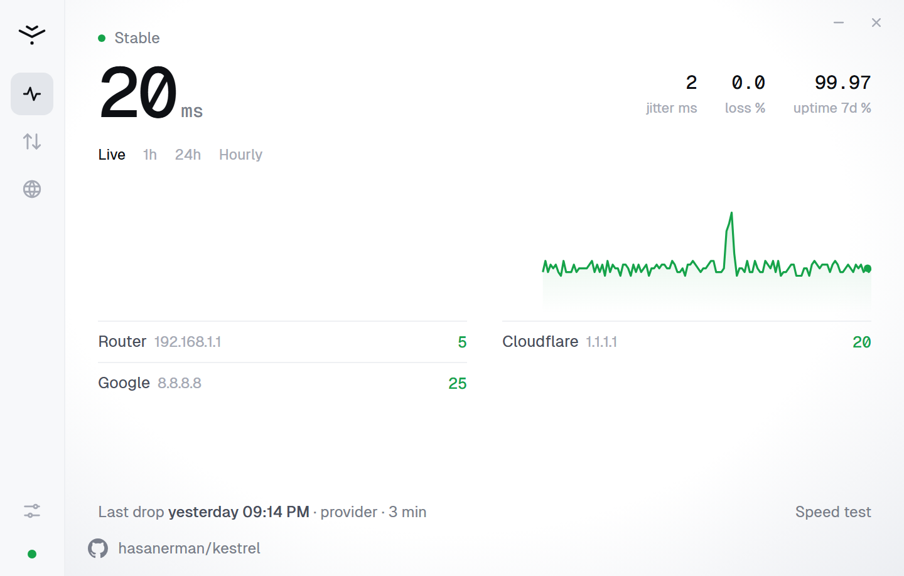
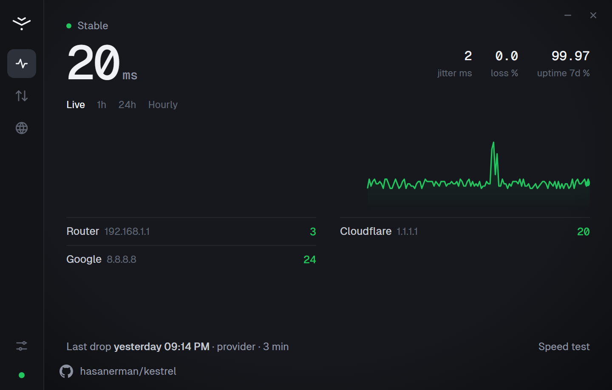
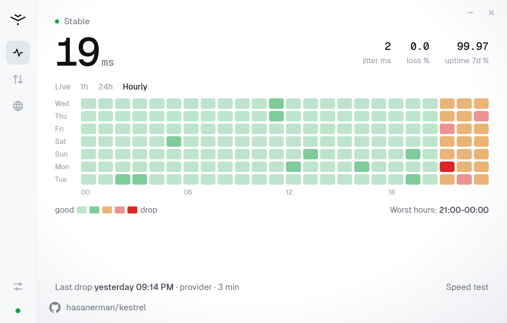
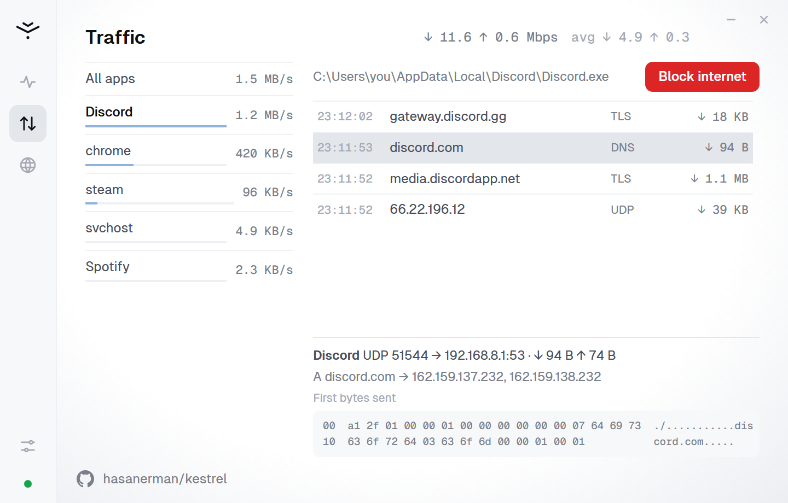
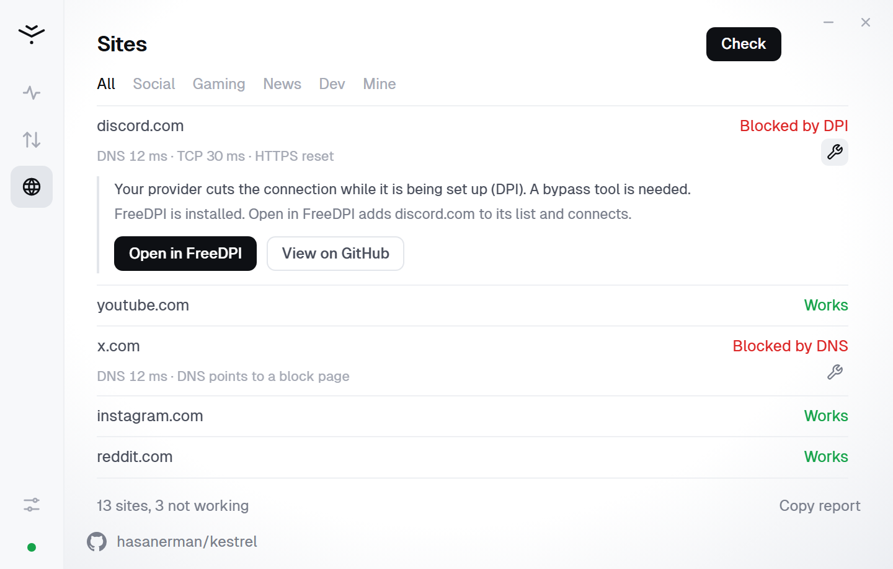
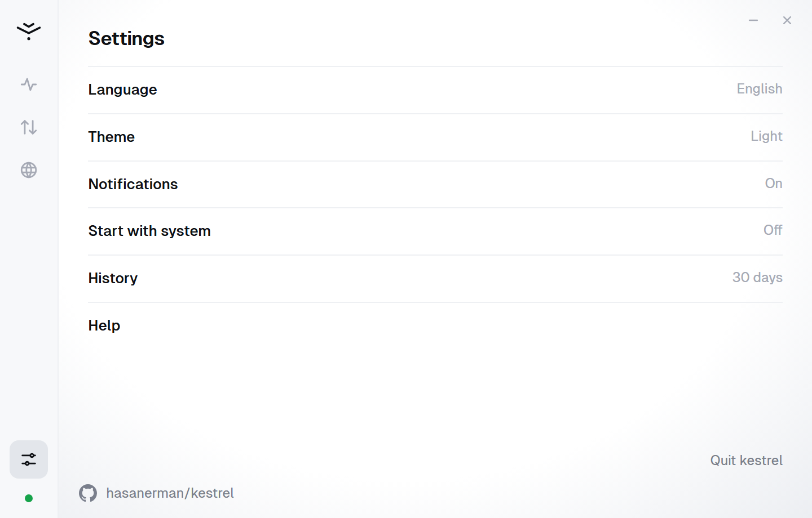

<h1 align="center">kestrel</h1>

<p align="center">
  Watches your internet connection, the apps that use it and the sites you can reach.
</p>

<p align="center">
  <a href="https://github.com/hasanerman/kestrel/releases/latest"></a>
  <a href="https://github.com/hasanerman/kestrel/releases"></a>
  <a href="LICENSE"></a>
  
</p>

<p align="center">
  
  
</p>

kestrel is a small desktop app for the question "why is my internet bad right now?". It measures your connection every second, remembers every drop, shows which program is using the network and tells you in plain words whether a site is down or blocked.

Everything stays on your computer. kestrel has no account, no telemetry and no server of its own.

## Download

Get the latest version from the [releases page](https://github.com/hasanerman/kestrel/releases/latest).

| System | File |
| --- | --- |
| Windows 10 and 11 (64-bit) | `kestrel_x.y.z_x64-setup.exe` |
| macOS 11 or newer (Intel and Apple silicon) | `kestrel_x.y.z_universal.dmg` |
| Linux | `kestrel_x.y.z_amd64.deb` or `kestrel_x.y.z_amd64.AppImage` |

kestrel updates itself. When a new version is out, a short note with what changed appears at the bottom of the window.

## Features

### Connection health

Live ping, jitter and packet loss to your router, Cloudflare and Google, measured with ICMP and a TCP fallback. The tray icon turns green, amber or red with the connection, and you get a notification when the internet drops and when it comes back.

Every drop is saved with its start, end and cause. kestrel tells a problem with your internet provider apart from a problem with your Wi-Fi or router, so "Last drop yesterday 21:14, provider, 3 min" is something you can show to your provider.

### Hourly view

<p align="center">
  
</p>

A heat map of the last seven days, one square per hour, colored by ping, loss and drops. Hover a square for the numbers. kestrel points out the worst hours of the day and shows your uptime for the week.

### Traffic

<p align="center">
  
</p>

Download and upload per app, live and since kestrel started. Every connection shows the site it talks to, taken from DNS answers, the TLS server name and HTTP requests. Select a connection to see its details and the first bytes it sent or received.

Block any app from the internet with one click. kestrel adds a Windows Firewall rule and removes all of its rules when you uninstall it.

Traffic and blocking are available on Windows and need administrator rights. Encrypted content (HTTPS, QUIC) cannot be read, only the site name.

### Site checker

<p align="center">
  
</p>

kestrel tests each site step by step: your provider's DNS against secure DNS, the TCP connection and the HTTPS handshake. The result is one plain verdict: works, blocked by DNS, blocked by DPI, certificate replaced, does not answer, site is down or no internet.

Built-in lists cover social, gaming, news and developer sites, and you can add your own. Copy the report to share it.

kestrel only diagnoses. For blocked sites the wrench button explains the block and opens the site in [FreeDPI](https://github.com/hasanerman/FreeDPI), the bypass app from the same author.

### Speed test

Download and upload speed from Cloudflare's speed servers, run on demand from the Health screen.

### Settings

<p align="center">
  
</p>

English, Turkish and Russian. Light, dark or system theme. Start with the system, notifications, how long history is kept (7, 30 or 90 days), copyable diagnostics and a link to report a problem.

## Platform support

| | Windows | macOS | Linux |
| --- | --- | --- | --- |
| Ping, loss, outages, history | Yes | Yes | Yes |
| Site checker | Yes | Yes | Yes |
| Speed test | Yes | Yes | Yes |
| Traffic per app | Yes | Later | Later |
| Block an app | Yes | No | Later |

## Privacy

kestrel stores ping history and outages in a local database in your user folder. Traffic is shown live and never written to disk. Nothing is uploaded. The only network requests kestrel makes on its own are the ping targets, the update check on GitHub, secure DNS lookups during a site check and the speed test when you start it.

## Build from source

You need [Node.js](https://nodejs.org) 22 and [Rust](https://rustup.rs). On Linux, also install the [Tauri prerequisites](https://v2.tauri.app/start/prerequisites/).

```
npm install
npm run tauri dev
```

The traffic monitor needs administrator rights, so start the terminal as administrator to try it in development. Release builds on Windows ask for these rights when they start.

## License

[GPL-3.0-only](LICENSE)
